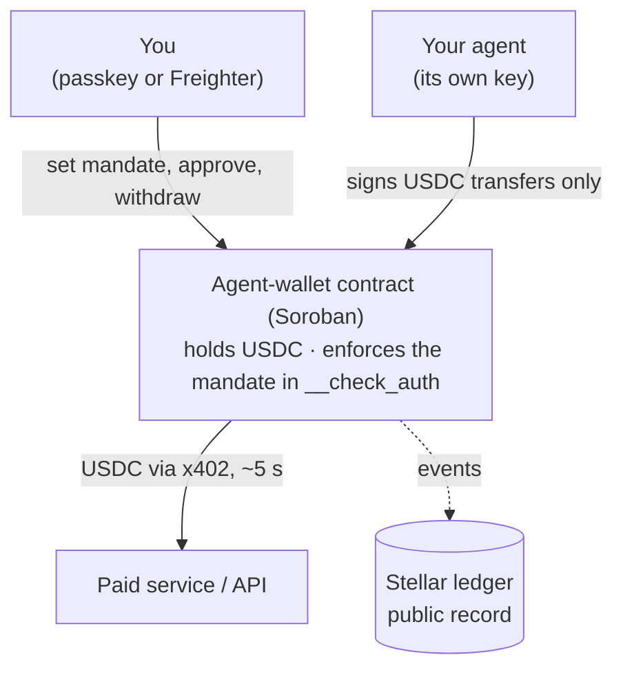
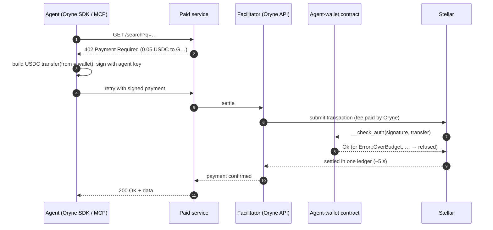
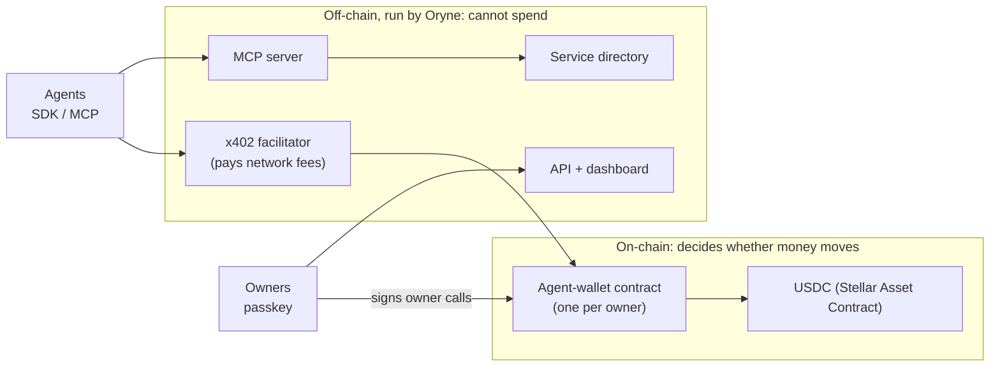

# Oryne

**Wallets for AI agents, with limits they can't break.**

Oryne is the mandate layer for agent payments on [Stellar](https://stellar.org). It gives an AI
agent a wallet it can spend from, and enforces the limits you set (budget, per-payment cap,
allowed services, expiry) in a Soroban smart contract. The limits hold even if the agent is
prompt-injected, its key leaks, or Oryne's own servers are breached.

> **Status: open on Stellar testnet; a small, invite-only pilot on mainnet.** Sign in at
> [oryne.org](https://oryne.org) with Google, GitHub, an email code or Freighter, deploy your own
> agent-wallet contract (owned by your device's passkey or your Freighter account), connect
> agents with on-chain mandates, and approve the payments they're not allowed to make alone. The
> contract is **not yet audited**: on mainnet, use small amounts. See [What's real today](#whats-real-today).

**Try it in five minutes:** the [research agent example](examples/research-agent) is a DeepSeek agent
that pays for research from its own wallet, gets refused when it goes over its limit, and asks you to
approve.

---

## Contents

- [The problem](#the-problem)
- [How Oryne works](#how-oryne-works)
- [Use it](#use-it): give your AI a wallet · build an agent · get paid by agents
- [Architecture](#architecture)
- [Why Stellar](#why-stellar)
- [What's real today](#whats-real-today)
- [Repository layout](#repository-layout)
- [Running it locally](#running-it-locally)
- [Hosting](#hosting)
- [Contributing](#contributing)
- [Roadmap](#roadmap)

---

## The problem

AI agents are starting to act, not just advise. To finish a task, an agent often has to pay for
something: a search API, a dataset, compute, a ticket. Today there are two bad options:

1. **Give the agent a card or an API key with a balance.** It can spend everything, and a single
   bad prompt or leaked key can drain it.
2. **Use a custodial "agent wallet" service.** The limits live in the provider's database, the
   provider holds the money, and you are trusting their servers.

Oryne takes a third route: **the money stays in a wallet you own, and the limits are code on
Stellar that refuses any payment outside them, whoever asks.**

## How Oryne works

There are three moving parts: **a wallet you own**, **an agent with its own key**, and **a
contract standing between them**.



### The mandate

Each agent gets a policy, stored in your wallet contract:

| Field | Meaning |
|---|---|
| `token` | The one asset the agent may spend (USDC) |
| `per_tx` | Most it can pay in a single payment |
| `budget` / `window_secs` | Most it can pay per window (e.g. 30 days) |
| `payees` | The services it may pay. Empty means any |
| `expires_at` | When its key stops working |

On every payment, the Stellar network calls the wallet's `__check_auth`, which verifies the
agent's signature and checks the transfer against that policy. If anything fails, the
transaction is refused and **nothing moves**:

`UnknownAgent` · `AgentPaused` · `AgentExpired` · `NotATransfer` · `WrongToken` ·
`PayeeNotAllowed` · `OverPerTxLimit` · `OverBudget`

When an agent needs to go beyond its mandate, it **asks you**. Approving signs `approve_once`
with your passkey: a one-time allowance for exactly that payee and amount, used up by the next
matching payment.

### One payment, end to end



---

## Use it

### Give an AI you already use a wallet

*You use Claude for research. It keeps hitting paid APIs, and you want it to pay for them itself,
without being able to drain your money.*

1. **Sign in** at [oryne.org/app](https://oryne.org/app). With Google, GitHub or an email code,
   your device creates a **passkey** that owns your new wallet contract: no seed phrase, no XLM,
   Oryne pays the network fees.
2. **Add money.** On testnet: free test USDC. On mainnet: send USDC on Stellar to your wallet's
   address (C…). The money sits in *your* contract; Oryne never holds it.
3. **Connect an agent:** a name, a per-payment cap and a budget. Your passkey signs
   `add_agent(key, policy)`, so the limits now live on Stellar. You get the agent's secret once,
   with a ready config for Claude, Cursor or any MCP client. (Lost it? *Get a new key*, after an
   email code.)
4. **Paste the config.** Your AI gets the tools `fetch_paid`, `wallet_status`, `find_service` and
   `request_approval`, from [`@oryne/mcp`](packages/mcp).
5. **Watch and steer** from the dashboard: **Activity** has every payment with its Stellar
   transaction, **Approvals** has the payments that need you, and each agent can be paused, have its
   limits changed or be disconnected, effective within one ledger.

### Build an agent that pays

```sh
npm install @oryne/agent
```

```ts
import { OryneAgent } from '@oryne/agent'

const agent = new OryneAgent({ secret: process.env.ORYNE_AGENT_SECRET })
// Pays 402 Payment Required from the agent's wallet, inside its mandate, then retries.
const res = await agent.fetch('https://demo.oryne.org/search?q=stellar')
```

When the wallet refuses, `fetch` throws a `PaymentRefusedError` with the reason; the agent can then
`requestApproval(…)` and `waitForApproval(id)`. A complete agent is in
[`examples/research-agent`](examples/research-agent).

**In Python** (LangChain, CrewAI, LlamaIndex or a plain script), the same SDK is
[`oryne`](packages/python):

```sh
pip install oryne
```

```python
import os
from oryne import OryneAgent

agent = OryneAgent(os.environ["ORYNE_AGENT_SECRET"])
res = agent.fetch("https://demo.oryne.org/search", params={"q": "stellar"})
```

**In your agent framework**, hand the model the same four tools the MCP server has (`fetch_paid`,
`wallet_status`, `request_approval`, `find_service`), ready-made for the **Vercel AI SDK**, the
**OpenAI Agents SDK**, **LangChain / LangGraph**, **CrewAI**, and plain OpenAI-style or Claude tool
calling:

```ts
const tools = oryneTools(agent)                       // @oryne/agent
generateText({ model, tools: aiSdkTools(tools, { tool, jsonSchema }), prompt })
```

```python
tools = oryne_langchain_tools(agent)                  # pip install "oryne[langchain]"
```

See [Framework integrations](https://oryne.org/docs#frameworks) for each one, and
[`examples/frameworks`](examples/frameworks) for the same research agent built with each framework.

The **developer console** ([oryne.org/app/developers](https://oryne.org/app/developers)) has API
keys, a **Playground** that shows each step of a payment (and what a refusal looks like), logs,
usage, an AI debugger, and **webhooks** for `payment.settled`, `payment.refused`,
`approval.requested`, `approval.approved` and `approval.declined`, so your app can tell a user
"your agent needs approval".

### Get paid by agents

*You run an API and want agents to pay per call, with no accounts, cards or invoices.*

```sh
npm install @oryne/merchant
```

```ts
import { Hono } from 'hono'
import { paywall } from '@oryne/merchant'

const app = new Hono()
const pay = paywall({ payTo: process.env.STELLAR_ADDRESS, facilitator: 'https://testnet-apiv1.oryne.org/v1/x402' })

app.get('/search', pay('0.05', 'Search results'), (c) => c.json(results)) // 0.05 USDC per call
```

Express works too, with `expressPaywall`. Unpaid requests get `402 Payment Required`; paid ones go
through once the USDC settles, in about 5 seconds. Payments are final: no chargebacks. Any x402
client can pay you, not only Oryne agents. The [demo merchant](examples/demo-merchant) is a complete
example, about 70 lines.

---

## Architecture



**The design rule:** everything that decides whether money moves is on-chain. Everything Oryne
runs off-chain makes the product pleasant to use, but cannot spend a cent. Oryne never stores
agent secrets or owner keys.

### Why this is the moat

- **Non-custodial enforcement.** Most agent-payment products are custodial: the limits are a
  row in their database. Oryne's limits are code in a wallet the user owns.
- **Verifiable receipts.** Every payment ties back to an agent key and the mandate that allowed
  it, on a public ledger. That's an audit trail finance teams can rely on.
- **Network effects over time.** Agent identity and reputation, plus a directory of services
  that accept agent payments.
- **Stellar's reach.** Anchors connect wallets to local money in markets where cards are weak.

## Why Stellar

| | |
|---|---|
| **~5 s finality** | Payments are final, not pending |
| **Fees well under a cent** | A $0.01 payment still makes sense |
| **Native USDC** | Issued on Stellar by Circle, not bridged |
| **x402 on Stellar** | An open agent-payment protocol, already live on mainnet |
| **Soroban smart accounts** | Custom `__check_auth` makes policy-enforcing wallets possible |
| **Anchors** | Cash in and out in local currency, including mobile money |

---

## What's real today

| Piece | Status |
|---|---|
| Agent-wallet contract ([`contracts/agent-wallet`](contracts/agent-wallet)) | ✅ 16 tests in CI; deployed on **testnet** and **mainnet**. ⏳ Not independently audited |
| API ([`services/api`](services/api)): sign-in, wallets, agents, approvals, x402 facilitator, webhooks | ✅ Hosted on testnet ([testnet-apiv1.oryne.org](https://testnet-apiv1.oryne.org/v1/info)) and mainnet (invite-only) |
| Dashboard and developer console ([oryne.org/app](https://oryne.org/app)) | ✅ Live, with a Test / Live switch |
| Sign-in: Google, GitHub, email code, Freighter; passkey-owned wallets | ✅ Working, including real device passkeys |
| SDKs on npm: [`@oryne/agent`](https://www.npmjs.com/package/@oryne/agent), [`@oryne/merchant`](https://www.npmjs.com/package/@oryne/merchant), [`@oryne/mcp`](https://www.npmjs.com/package/@oryne/mcp), [`@oryne/core`](https://www.npmjs.com/package/@oryne/core) | ✅ Published |
| Python SDK ([`packages/python`](packages/python), `oryne` on PyPI) | ✅ Unit tests checked against the TypeScript SDK's signatures; pays, is refused and gets approval on testnet. Published on [PyPI](https://pypi.org/project/oryne/) |
| [Research agent example](examples/research-agent): DeepSeek + `@oryne/agent` from npm | ✅ Pays, refused over its limit, asks for approval, pays (testnet) |
| [Demo merchant](examples/demo-merchant) | ✅ Hosted on testnet: demo.oryne.org |
| End-to-end test ([`scripts/e2e.ts`](scripts/e2e.ts)) | ✅ Passes on testnet for both owner types: pay → refused over limit → approve once → pay |
| Framework integrations: Vercel AI SDK, OpenAI Agents SDK, LangChain, CrewAI, OpenAI-style and Claude tool calling | ✅ Tested against each framework's current release (`oryneTools` in `@oryne/agent`, `oryne.integrations` in Python) |
| MCP server ([`@oryne/mcp`](packages/mcp)) | ✅ Every tool checked over stdio, as Claude Desktop runs it, on testnet: source and the npm package (`npm run mcp-check`) |
| Card top-ups (Paystack) | ✅ On testnet. ⏳ Mainnet needs a live Paystack account and a funded treasury |
| Audit, open mainnet, anchors for fiat in and out | ⏳ Roadmap |

On testnet the API creates its own **test USDC** (and a faucet for it). On mainnet it uses
Circle's USDC. Mainnet is **invite-only** for now: request access from the dashboard's Live mode.

## Repository layout

```
.
├── apps/web/                  Website, dashboard (/app) and developer console (/app/developers)
├── apps/admin/                Admin site: its own repository, not tracked here (see .gitignore)
├── services/api/              Oryne API: Hono on Node 22, Postgres (SQLite locally), Stellar RPC
├── packages/
│   ├── core/                  Contract encoders, payment signing, x402 payload format
│   ├── agent/                 @oryne/agent: fetch() that pays from the agent wallet
│   ├── merchant/              @oryne/merchant: paywall middleware (Hono, Express)
│   ├── mcp/                   @oryne/mcp: MCP server for Claude, Cursor, …
│   └── python/                oryne (PyPI): the agent SDK for Python
├── examples/
│   ├── demo-merchant/         A small paid API agents buy from (hosted on testnet)
│   ├── research-agent/        A DeepSeek agent with an Oryne wallet; installs the SDK from npm
│   └── frameworks/            The same agent with the AI SDK, OpenAI Agents, LangChain and CrewAI
├── contracts/                 Soroban workspace (Rust): the agent-wallet contract
├── scripts/                   setup.ts (testnet merchant), e2e.ts (whole flow), mcp-check.ts (MCP server), packages.ts (npm builds)
├── deploy/                    Hosting with Docker (deploy/docker) and the services' env templates
└── .github/                   CI (contract tests and wasm, web build, npm publish), issue and PR templates
```

## Running it locally

Needs **Node 22.18+**. No Rust needed: CI builds the contract and the API downloads the wasm
from the [`contracts-latest`](https://github.com/m2moryne/Oryne/releases/tag/contracts-latest)
release.

```sh
npm install

# 1. The API. First start on testnet creates a sponsor account, a test USDC and
#    uploads the wallet contract, then remembers them in services/api/data/.
npm run dev:api                 # http://localhost:8787

# 2. A paid API for agents to buy from (one-time setup creates its testnet address)
npm run setup
npm run dev:merchant            # http://localhost:8788

# 3. Check the whole flow without a browser
npm run e2e                     # owner = Stellar account (as with Freighter)
npm run e2e -- passkey          # owner = passkey (needs DEV_LOGIN=1 in services/api/.env)
npm run mcp-check               # the MCP server over stdio, every tool, against hosted testnet

# 4. The website and dashboard
npm run dev:web                 # http://localhost:5173  →  /app
```

**In the dashboard** (`/app`) choose how to sign in:

- **Continue with Google / GitHub / email**: after signing in, *Create passkey and wallet* asks your
  device (Face ID, Touch ID, Windows Hello, or your phone) for a passkey. That passkey owns the
  wallet and approves every change. No extension, no recovery phrase, no XLM.
- **Continue with Freighter**: your Stellar account owns the wallet (setup below).
- **Continue as a test user**: appears on testnet when `DEV_LOGIN=1`; same passkey flow,
  without OAuth.

Then *Funds → Add money → Test USDC*, and *Agents → Connect agent*. The agent's secret is shown
once; give it to your agent:

```sh
ORYNE_AGENT_SECRET=S... ORYNE_API_URL=http://localhost:8787 npm run mcp     # MCP, for Claude/Cursor
```

or in code:

```ts
import { OryneAgent } from '@oryne/agent'
const agent = new OryneAgent({ secret: process.env.ORYNE_AGENT_SECRET, apiUrl: 'http://localhost:8787' })
const res = await agent.fetch('http://localhost:8788/quote') // pays 0.01 USDC
```

**Checks:** `npm run typecheck`, `npm test`, `npm run build`.

### Google and GitHub sign-in

Copy `services/api/.env.example` to `services/api/.env`, then create the two OAuth apps.

**Google**: [Google Cloud Console](https://console.cloud.google.com/apis/credentials)
1. Create a project (or pick one), then *APIs & Services → OAuth consent screen*: choose
   *External*, add an app name and your email, add the scopes `openid`, `email`, `profile`, and
   add yourself as a test user.
2. *Credentials → Create credentials → OAuth client ID → Web application*.
3. Authorized redirect URI: `http://localhost:8787/v1/auth/oauth/google/callback`
4. Put the client ID and secret in `GOOGLE_CLIENT_ID` and `GOOGLE_CLIENT_SECRET`.

**GitHub**: [Developer settings → OAuth Apps → New OAuth App](https://github.com/settings/applications/new)
1. Homepage URL: `http://localhost:5173`
2. Authorization callback URL: `http://localhost:8787/v1/auth/oauth/github/callback`
3. Register, then *Generate a new client secret*. Put them in `GITHUB_CLIENT_ID` and
   `GITHUB_CLIENT_SECRET`.

Restart the API; the buttons switch on by themselves. For a deployed site, add the production
callback URLs (`https://<your api>/v1/auth/oauth/<provider>/callback`) and set `PUBLIC_URL` and
`WEB_URL`. A GitHub OAuth app has one callback URL, so each deployed API (testnet, mainnet) needs
its own.

Google and GitHub only prove who someone is. They have no power over the wallet: the passkey
does, and it never leaves the user's device.

### Freighter

1. Install the extension from [freighter.app](https://www.freighter.app) and create a wallet
   (password + 12-word recovery phrase; keep the phrase offline).
2. *Settings → Network → Testnet*, then *Fund with Friendbot* for test XLM.
3. In the dashboard choose *Continue with Freighter*.

**Contract** (Rust + Stellar CLI, or just push and let CI do it):

```sh
cd contracts
cargo test
stellar contract build
```

## Hosting

The testnet API (`testnet-apiv1.oryne.org`), the mainnet API (`apiv1.oryne.org`) and the demo
merchant (`demo.oryne.org`) run on our own server with Docker, behind nginx with HTTPS, and are
redeployed automatically within a minute of a push to `master`:
[`deploy/docker/README.md`](deploy/docker/README.md). The website is on Vercel (`vercel.json`).

## Contributing

Contributions are welcome: bug reports, docs, examples and code. Start with
[CONTRIBUTING.md](CONTRIBUTING.md), and look for issues labelled
[`good first issue`](https://github.com/m2moryne/Oryne/labels/good%20first%20issue).

Found a security problem? Please report it privately: see [SECURITY.md](SECURITY.md).

## Roadmap

| Stage | Focus | What ships |
|---|---|---|
| **Now** | The wallet | Contract on testnet and a mainnet pilot · dashboard and developer console · SDKs and MCP server on npm · first paid services |
| **Next** | Open mainnet | Independent audit → mainnet for everyone · card and mobile-money top-ups · anchor funding and cash-out · more examples · more SDK languages after Python (framework integrations ✅) |
| **Then** | The network | Agent-searchable directory with ranking · team and company policies · verifiable agent identity and reputation |
| **Later** | The economy | Agents paying agents with escrow · credit for agents with a track record · cross-border payouts in local money |

**What we measure:** agent wallets deployed, USDC volume, payments settled on Stellar, active
agents, and services accepting agent payments.

---

*Oryne is MIT licensed. To join the mainnet pilot, talk to us, or list your API, use the
[contact page](https://oryne.org/contact).*
