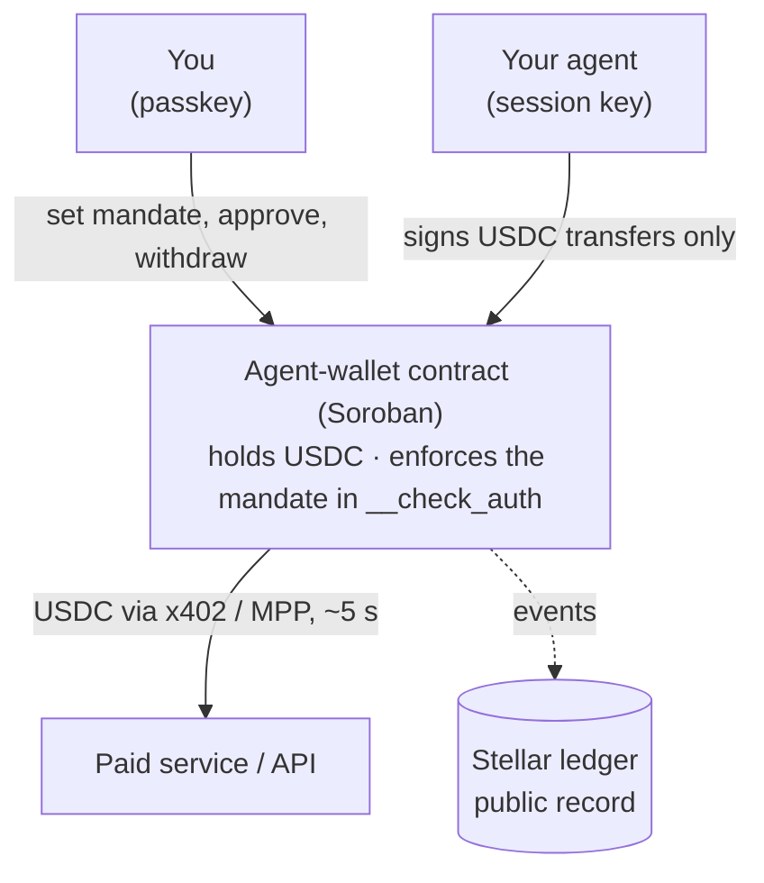
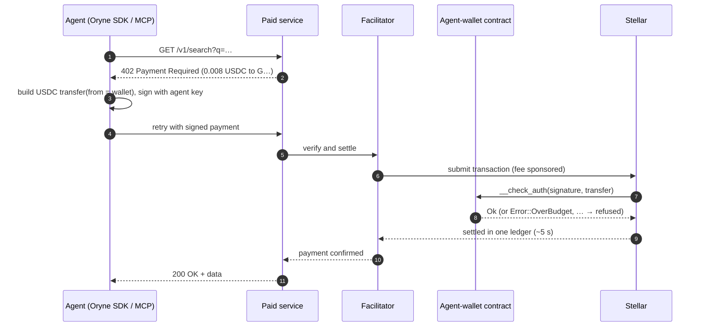
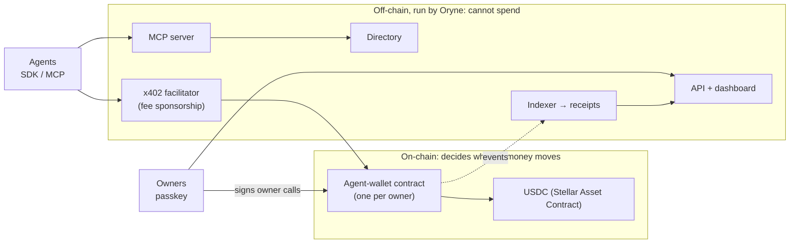

# Oryne

**Wallets for AI agents, with limits they can't break.**

Oryne is the mandate layer for agent payments on [Stellar](https://stellar.org). It gives an AI
agent a wallet it can spend from, and enforces the limits you set (budget, per-payment cap,
allowed services, expiry) in a Soroban smart contract. The limits hold even if the agent is
prompt-injected, its key leaks, or Oryne's own servers are breached.

> **Status: working MVP on Stellar testnet.** Owners sign in with Google, GitHub or Freighter,
> deploy their own agent-wallet contract (owned by a device passkey or their Freighter account), connect agents with on-chain mandates, and approve out-of-policy
> payments. Agents pay x402-style services in (test) USDC, and the contract refuses anything
> outside the mandate. The contract is not yet audited; don't use it with real funds. See
> [What's real today](#whats-real-today).

---

## Contents

- [The problem](#the-problem)
- [How Oryne works](#how-oryne-works)
- [Scenario 1: connecting an agent you already use](#scenario-1-connecting-an-agent-you-already-use)
- [Scenario 2: a developer building an agent product](#scenario-2-a-developer-building-an-agent-product)
- [Scenario 3: getting paid by agents](#scenario-3-getting-paid-by-agents)
- [Architecture](#architecture)
- [Why Stellar](#why-stellar)
- [What's real today](#whats-real-today)
- [Repository layout](#repository-layout)
- [Running it locally](#running-it-locally)
- [Roadmap](#roadmap)

---

## The problem

AI agents are starting to act, not just advise. To finish a task, an agent often has to pay for
something: a search API, a dataset, compute, a ticket. Today there are two bad options:

1. **Give the agent a card or an API key with a balance.** It can spend everything, and a single
   bad prompt or leaked key can drain it.
2. **Use a custodial "agent wallet" service.** The limits live in the provider's database, the
   provider holds the money, and you are trusting their servers.

Oryne takes a third route: **the money stays in a wallet you own, and the limits are code on
Stellar that refuses any payment outside them, whoever asks.**

## How Oryne works

There are three moving parts: **a wallet you own**, **an agent with its own key**, and **a
contract standing between them**.



### The mandate

Each agent gets a policy, stored in your wallet contract:

| Field | Meaning |
|---|---|
| `token` | The one asset the agent may spend (USDC) |
| `per_tx` | Most it can pay in a single payment |
| `budget` / `window_secs` | Most it can pay per window (e.g. 30 days) |
| `payees` | The services it may pay. Empty means any |
| `expires_at` | When its key stops working |

On every payment, the Stellar network calls the wallet's `__check_auth`, which verifies the
agent's signature and checks the transfer against that policy. If anything fails, the
transaction is refused and **nothing moves**:

`UnknownAgent` · `AgentPaused` · `AgentExpired` · `NotATransfer` · `WrongToken` ·
`PayeeNotAllowed` · `OverPerTxLimit` · `OverBudget`

When an agent needs to go beyond its mandate, it **asks you**. Approving signs `approve_once`
with your passkey: a one-time allowance for exactly that payee and amount, used up by the next
matching payment.

### One payment, end to end



---

## Scenario 1: connecting an agent you already use

*You use Claude for research. It keeps hitting paid data and search APIs, and you want it to pay
for them itself, without being able to drain your money.*

| # | You do | In the preview | In the real product |
|---|---|---|---|
| 1 | Land on the site | Home → **"Try to break it"**: drag the amount past $25 and watch the contract refuse it | Same |
| 2 | Click **Connect an agent**, sign in | Any sign-in button works | Sign-up creates a **passkey** (no seed phrase) and deploys **your own agent-wallet contract**, owned by that passkey. Oryne pays the setup fees, so you never need XLM |
| 3 | **Add funds** | Choose USDC on Stellar, bank transfer, mobile money or card | Funds land in *your* contract as USDC, through a Stellar anchor if you paid in local money. Oryne never holds them |
| 4 | **Connect the agent**: name → mandate → connect | $400 a month, $25 per purchase; you get an agent key and a ready Claude/MCP config | A new session key is generated; your passkey signs `add_agent(key, policy)`. The limits now live on Stellar |
| 5 | Paste the config into Claude | — | Claude gets the tools `pay`, `balance`, `find_service`, `request_approval` |
| 6 | The agent works and pays as it goes | **Overview / Activity**: simulated purchases every 15–30 s. Open one to see the receipt: protocol, tx hash, ledger, signer, checks | 402 → signed transfer → contract check → settled in ~5 s |
| 7 | The agent wants something outside its limits | **Approvals**: an $84.50 train ticket over a $60 cap → **Approve once** | Your passkey signs `approve_once` for that payee and amount only |
| 8 | Tighten control | **Services**: untick a service and that agent can't pay it. **Agent page**: expiry, pause, disconnect. **Wallet**: contract, keys, event log | `set_policy`, `set_paused`, `remove_agent`: effective within one ledger |

**What this person gets:** an agent that can spend, with limits even a compromised agent can't
get around, without touching crypto.

## Scenario 2: a developer building an agent product

*You're building "Tripwise", a travel-planning agent with thousands of users. Each user's agent
needs to search flights, check hotels and book trains.*

1. **Developer console** (`/dev`). Install the SDK and create a test key. The sidebar's
   test/live switch maps to Stellar **testnet** and **mainnet**.
2. **Wire up the agent.** One `fetch` that pays:

   ```ts
   import { OryneAgent } from '@oryne/agent'

   const agent = new OryneAgent({ key: userAgentKey })
   // Answers 402 Payment Required from the user's wallet, inside their mandate, then retries.
   const res = await agent.fetch('https://api.skylanefares.example/v1/search?from=NBO&to=LHR')
   ```

   Each Tripwise user has **their own wallet and mandate**, so Tripwise never holds user money.
3. **Try it in the Playground** (`/dev/playground`). Pick an agent, a service and a quantity,
   then click **Send request**. You'll see six steps animate: request → 402 → signed transfer →
   contract check → settlement → 200 OK. Push the quantity over the agent's limit and step 4
   fails with `Error::OverPerTxLimit`. Click **Ask the owner to approve it** and the request
   shows up in the owner's **Approvals**.
4. **Find services** (`/directory`). Agents can also search the directory themselves with
   `find_service`.
5. **Monitor.** The console has Agents, Logs, Usage and **Webhooks**: `payment.settled`,
   `payment.declined`, `approval.requested` and more, so your app can tell the user "your agent
   needs approval for this train".
6. **Contracts** (`/dev/contracts`). Version, wasm hash, deploy commands, the full interface and
   the error codes your app should handle.

Or skip the SDK and use the **MCP server**:

```json
{
  "mcpServers": {
    "oryne": {
      "command": "npx",
      "args": ["@oryne/mcp"],
      "env": { "ORYNE_AGENT_KEY": "oryne_agent_…" }
    }
  }
}
```

## Scenario 3: getting paid by agents

*You run an API and want agents to pay per call, with no accounts, cards or invoices.*

In the console, open **Accept payments** (`/dev/merchant`):

```ts
import express from 'express'
import { paywall } from '@oryne/merchant'

const app = express()
const pay = paywall({ payTo: process.env.STELLAR_ADDRESS, network: 'stellar-testnet' })

app.get('/v1/search', pay('0.008'), search) // 0.008 USDC per call
```

- Unpaid requests get `402 Payment Required`. Paid ones go through once the USDC settles, in
  about 5 seconds.
- Settled payments are final: there are no chargebacks.
- Any x402 client can pay you, not only Oryne agents.
- Turn on **List in the Oryne directory** and agents can find you.

---

## Architecture



**The design rule:** everything that decides whether money moves is on-chain. Everything Oryne
runs off-chain makes the product pleasant to use, but cannot spend a cent.

### Why this is the moat

- **Non-custodial enforcement.** Most agent-payment products are custodial: the limits are a
  row in their database. Oryne's limits are code in a wallet the user owns.
- **Verifiable receipts.** Every payment ties back to an agent key and the mandate that allowed
  it, on a public ledger. That's an audit trail finance teams can rely on.
- **Network effects over time.** Agent identity and reputation, plus a directory of services
  that accept agent payments.
- **Stellar's reach.** Anchors connect wallets to local money in markets where cards are weak.

## Why Stellar

| | |
|---|---|
| **~5 s finality** | Payments are final, not pending |
| **~0.00001 XLM fees** | A $0.001 payment still makes sense |
| **Native USDC** | Issued on Stellar, not bridged |
| **x402 and MPP live** | Open agent-payment protocols already run on Stellar mainnet |
| **Soroban smart accounts** | Custom `__check_auth` makes policy-enforcing wallets possible |
| **Anchors** | Cash in and out in local currency, including mobile money |

---

## What's real today

| Piece | Status |
|---|---|
| Agent-wallet contract ([`contracts/agent-wallet`](contracts/agent-wallet)) | ✅ Built and unit-tested in CI (10 tests); running on **testnet**. ⏳ Not audited |
| API ([`services/api`](services/api)): sign-in, wallets, agents, approvals, x402 facilitator | ✅ Working on testnet |
| Agent SDK ([`packages/agent`](packages/agent)): `fetch()` that pays | ✅ Working on testnet |
| Merchant middleware ([`packages/merchant`](packages/merchant)) + [demo merchant](examples/demo-merchant) | ✅ Working on testnet |
| MCP server ([`packages/mcp`](packages/mcp)) | ✅ Built on the agent SDK. ⏳ Not yet tried inside Claude Desktop |
| Passkey owners (Google/GitHub sign-in) | ✅ Contract verifies WebAuthn signatures (6 tests in CI); full flow passes on testnet with a simulated authenticator. ⏳ Not yet tried with a real device passkey |
| Google and GitHub sign-in | ✅ Built. ⏳ Needs your OAuth apps (see below) |
| Live dashboard at `/app` | ✅ Built and wired to the API. ⏳ Not yet clicked through in a browser |
| End-to-end test ([`scripts/e2e.ts`](scripts/e2e.ts)) | ✅ Passes on testnet for both owner types: pay → refused over limit → approve once → pay |
| Demo dashboard at `/demo` and the developer console at `/dev` | Simulated data, for showing the full vision |
| Mainnet, audit, anchors for fiat in and out | ⏳ Roadmap |

On testnet the API creates its own **test USDC** (and a faucet for it). On mainnet it uses
Circle's USDC.

## Repository layout

```
.
├── apps/web/                  Website, live dashboard (/app), demo (/demo), developer console (/dev)
├── apps/admin/                Admin site (standalone; its own repo and Vercel project later)
├── services/api/              Oryne API: Hono on Node 22, Postgres (SQLite locally), Stellar RPC
├── packages/
│   ├── core/                  Contract encoders, payment signing, x402 payload format
│   ├── agent/                 @oryne/agent: fetch() that pays from the agent wallet
│   ├── merchant/              @oryne/merchant: paywall middleware (Hono, Express)
│   └── mcp/                   @oryne/mcp: MCP server for Claude, Cursor, …
├── examples/demo-merchant/    A small paid API to try it all against
├── contracts/                 Soroban workspace (Rust): the agent-wallet contract
├── scripts/                   setup.ts (testnet merchant), e2e.ts (whole flow, headless)
└── .github/workflows/         CI: contract build + tests (publishes the wasm), web build
```

## Running it locally

Needs **Node 22.18+**. No Rust needed: CI builds the contract and the API downloads the wasm
from the [`contracts-latest`](https://github.com/m2moryne/Oryne/releases/tag/contracts-latest)
release.

```sh
npm install

# 1. The API. First start on testnet creates a sponsor account, a test USDC and
#    uploads the wallet contract, then remembers them in services/api/data/.
npm run dev:api                 # http://localhost:8787

# 2. A paid API for agents to buy from (one-time setup creates its testnet address)
npm run setup
npm run dev:merchant            # http://localhost:8788

# 3. Check the whole flow without a browser
npm run e2e                     # owner = Stellar account (as with Freighter)
npm run e2e -- passkey          # owner = passkey (needs DEV_LOGIN=1 in services/api/.env)

# 4. The website and dashboard
npm run dev:web                 # http://localhost:5173  →  /app
```

**In the dashboard** (`/app`) choose how to sign in:

- **Continue with Google / GitHub**: after signing in, *Create passkey and wallet* asks your
  device (Face ID, Touch ID, Windows Hello, or your phone) for a passkey. That passkey owns the
  wallet and approves every change. No extension, no recovery phrase, no XLM.
- **Continue with Freighter**: your Stellar account owns the wallet (setup below).
- **Continue as a test user**: appears on testnet when `DEV_LOGIN=1`; same passkey flow,
  without OAuth.

Then *Add test USDC → Connect agent*. The agent's secret is shown once; give it to your agent:

```sh
ORYNE_AGENT_SECRET=S... node packages/mcp/src/server.ts      # MCP, for Claude/Cursor
```

or in code:

```ts
import { OryneAgent } from '@oryne/agent'
const agent = new OryneAgent({ secret: process.env.ORYNE_AGENT_SECRET })
const res = await agent.fetch('http://localhost:8788/quote') // pays 0.01 USDC
```

**Checks:** `npm run typecheck`, `npm test`, `npm run build`.

### Google and GitHub sign-in

Copy `services/api/.env.example` to `services/api/.env`, then create the two OAuth apps.

**Google**: [Google Cloud Console](https://console.cloud.google.com/apis/credentials)
1. Create a project (or pick one), then *APIs & Services → OAuth consent screen*: choose
   *External*, add an app name and your email, add the scopes `openid`, `email`, `profile`, and
   add yourself as a test user.
2. *Credentials → Create credentials → OAuth client ID → Web application*.
3. Authorized redirect URI: `http://localhost:8787/v1/auth/oauth/google/callback`
4. Put the client ID and secret in `GOOGLE_CLIENT_ID` and `GOOGLE_CLIENT_SECRET`.

**GitHub**: [Developer settings → OAuth Apps → New OAuth App](https://github.com/settings/applications/new)
1. Homepage URL: `http://localhost:5173`
2. Authorization callback URL: `http://localhost:8787/v1/auth/oauth/github/callback`
3. Register, then *Generate a new client secret*. Put them in `GITHUB_CLIENT_ID` and
   `GITHUB_CLIENT_SECRET`.

Restart the API; the buttons switch on by themselves. For a deployed site, add the production
callback URLs (`https://<your api>/v1/auth/oauth/<provider>/callback`) and set `PUBLIC_URL` and
`WEB_URL`.

Google and GitHub only prove who someone is. They have no power over the wallet: the passkey
does, and it never leaves the user's device.

### Freighter

1. Install the extension from [freighter.app](https://www.freighter.app) and create a wallet
   (password + 12-word recovery phrase; keep the phrase offline).
2. *Settings → Network → Testnet*, then *Fund with Friendbot* for test XLM.
3. In the dashboard choose *Continue with Freighter*.

**Contract** (Rust + Stellar CLI, or just push and let CI do it):

```sh
cd contracts
cargo test
stellar contract build
```

## Roadmap

| Stage | Focus | What ships |
|---|---|---|
| **Now** | The wallet | Contract on testnet (open source) · dashboard · MCP server and SDKs · first paid services onboarded by hand |
| **Next** | Mainnet | Audit → mainnet with USDC · merchant kit · facilitator with sponsored fees · passkey wallets · anchor funding and cash-out |
| **Then** | The network | Agent-searchable directory with ranking · team and company policies · verifiable agent identity and reputation · MPP channels |
| **Later** | The economy | Agents paying agents with escrow · credit for agents with a track record · cross-border payouts in local money |

**MVP success metrics** (what we report publicly): agent wallets deployed, USDC volume, payments
settled on Stellar, active agents, and services accepting agent payments.

---

*Oryne is in early development. To join the pilot, talk to us, or list your API, use the
[contact page](https://oryne.org/contact).*
